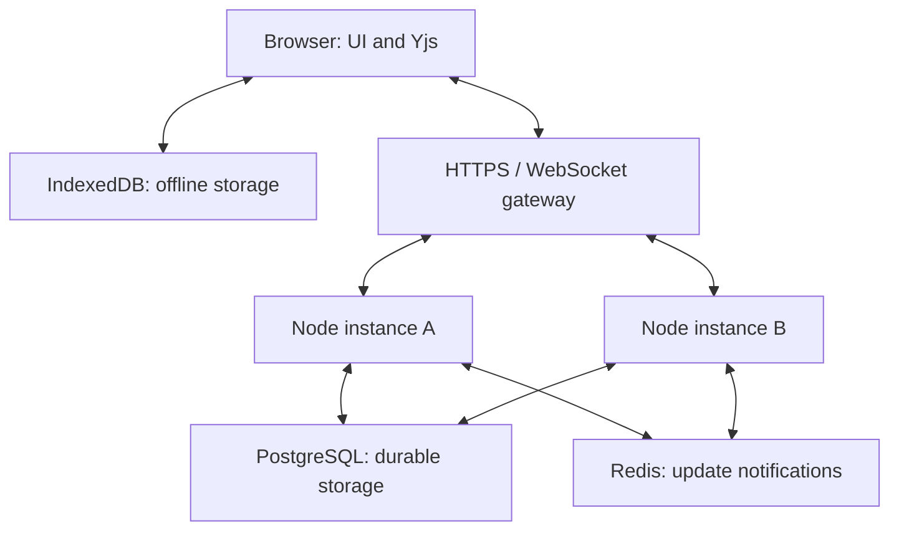

# TeamSync

### A shared workspace for ideas, documents, and projects

TeamSync is a real-time collaborative web application built for **Nexlevr Level 03 — Task 01**. Teams can write shared documents, organize work on Kanban boards, and continue editing previously opened spaces without a connection. Saved local changes merge with the server when the connection returns.

**Project status:** Local application implemented. Automated checks pass. Public deployment is pending.

## Task coverage

| Requirement | Implementation |
| --- | --- |
| Real-time collaboration | Authenticated WebSockets, shared documents, project boards, and live presence |
| Offline support | Yjs document state persisted in IndexedDB; service worker caches the built application shell |
| Scalability | PostgreSQL shared storage, Redis notifications, durable reconciliation, idle-room eviction, and snapshot compaction |
| Design explanation | [Technical post](docs/TECHNICAL-POST.md) and [architecture walkthrough](docs/ARCHITECTURE.md) |

The scale-out path is implemented but has not been validated under production load. No concurrency or throughput benchmark is claimed.

## Features

**Workspace experience**

- Responsive dashboard, document library, project boards, team directory, and settings.
- Shared plain-text editor with word count and local undo/redo.
- Kanban task creation, title/label editing, deletion, drag and drop, and keyboard-accessible status selectors.
- Presence avatars and editing indicators for connected teammates.
- Document TXT and board JSON exports.
- Calm green styling, subtle motion, mobile navigation, and reduced-motion support.

**Collaboration and recovery**

- Yjs CRDT merging for text and nested task fields.
- Per-account, per-document IndexedDB persistence.
- Service worker caching for offline reopening of the production application.
- WebSocket reconnection with backoff and jitter.
- Save acknowledgements after durable database writes.
- Connection heartbeat, slow-consumer protection, and periodic database reconciliation.
- Transactional snapshot compaction when active document history reaches 100 updates.

**Access control**

- Registration and sign-in with salted scrypt password hashes.
- Server-side sessions with hashed session tokens.
- HttpOnly, SameSite cookies; Secure cookies in production.
- Owner, editor, and viewer workspace roles enforced by the server.
- Editor/viewer invitation links valid for 24 hours.
- HTTP mutation and WebSocket Origin checks, authentication rate limits, and bounded update payloads.

## Technology

| Layer | Tools |
| --- | --- |
| Interface | JavaScript, CSS, Vite, Lucide icons |
| Collaboration | Yjs, WebSockets (`ws`), y-indexeddb |
| Backend | Node.js, Express |
| Local database | SQLite through `node:sqlite` |
| Shared deployment database | PostgreSQL |
| Cross-instance notifications | Redis |
| Offline application shell | Service worker and Cache API |
| Verification | Node.js test runner and HTTP/WebSocket integration tests |

## Local setup

### 1. Requirements

Install **Node.js 24 LTS** and npm. Check the installed versions:

```bash
node -v
npm -v
```

Task 01 does not require an external API key or Stripe account. Local development uses SQLite automatically.

### 2. Open the actual project folder

After extracting the ZIP, open the inner `TeamSync` directory containing `package.json`:

```bash
cd TeamSync-Level03-Task01/TeamSync
```

If your terminal is already inside that inner directory, skip this command.

### 3. Install and run

```bash
npm ci
npm run setup
npm run build
npm start
```

Expected startup message:

```text
TeamSync listening on port 3000
```

Open **http://localhost:3000**. Keep the terminal running while using the application.

`npm run setup` creates `.env` from `.env.example` if it is absent. Local database files are created inside `data/`. Keep that directory to retain accounts, workspaces, and acknowledged changes between restarts.

### 4. Create your first workspace

1. Choose **Create an account** and register.
2. Open the workspace selector in the sidebar and create a workspace.
3. Select **New space** and create a document or project board.
4. Use **Share** or **Invite teammate** to create an invitation.

### Development mode

```bash
npm run dev
```

Open **http://localhost:5173** for hot reload. The development server proxies API and WebSocket requests to the backend on port 3000.

Use the production build at port 3000 to test offline reopening; service worker registration is disabled in development mode.

## Test collaboration and offline editing

1. Open a document with the workspace owner account.
2. Generate an editor invitation and open it in a separate browser profile or incognito window.
3. Register/sign in with a different account and open the same document.
4. Type in either window. Verify the other receives changes and both show connected teammates.
5. Open the production app online, let the service worker install, and wait until the document shows **All changes synced**.
6. Disconnect the network, edit an opened space, and reload it to check local recovery.
7. Reconnect. Verify local changes sync and both clients converge.
8. Repeat with a project board. Use a viewer invitation to check read-only access.

**Offline boundary:** previously opened spaces can be edited from their local copy. Unopened spaces cannot be downloaded offline. Registration, workspace/document creation, renaming, and invitations require a connection. Browser storage can be cleared or evicted and is not a substitute for backups.

## Architecture



For local single-instance use, SQLite replaces PostgreSQL and Redis is optional.

**Write path:** local CRDT edit → IndexedDB persistence and WebSocket transmission → server validation → durable database insert → acknowledgement and broadcast.

**Reconnect path:** load local state → receive server state → CRDT merge → upload merged local state → persist and acknowledge.

Redis carries notifications; the database remains the source of truth. Periodic reconciliation recovers missed notifications. PostgreSQL advisory locks serialize update insertion and compaction per document. Idle in-memory rooms are evicted and rebuilt from durable records when needed.

See [docs/ARCHITECTURE.md](docs/ARCHITECTURE.md) for failure handling and deployment considerations.

## Verification

```bash
npm run check
npm test
npm run build
```

| Check | Result |
| --- | --- |
| JavaScript syntax checks | Passed |
| Four automated test scenarios | Passed |
| Production frontend build | Passed |
| Built shell, service worker, and health endpoint HTTP smoke checks | Passed |
| Browser layout and actual IndexedDB/service-worker offline recovery | Manual verification pending |
| PostgreSQL/Redis multi-instance integration and load testing | Pending |

Automated scenarios cover live HTTP/WebSocket collaboration, concurrent disconnected CRDT-state merges, viewer write rejection, workspace isolation, invalid credentials, cross-origin request rejection, restart recovery, logout revocation, independent task-field merging, duplicate/reordered updates, and snapshot compaction. Tests use temporary SQLite databases.

The disconnected-state test verifies CRDT convergence; it does not replace a browser offline-storage test. Follow [docs/TESTING.md](docs/TESTING.md) before recording or deploying.

## Deployment guide

### Hosting requirements

Choose a host that runs a persistent **Node.js process or container**, accepts **WebSocket upgrades**, and provides an **HTTPS URL**. Deploy the backend and built frontend together; a static frontend upload alone cannot provide collaboration.

Use either:

- **Single instance:** SQLite with persistent storage mounted at the application's `data/` directory.
- **Shared deployment:** PostgreSQL and Redis shared by all application instances.

Do not run multiple instances against a SQLite file. An ephemeral filesystem can lose local SQLite data when the container is replaced.

### Build and start commands

Run these from the folder containing `package.json`:

```bash
# Build stage: include development dependencies because Vite is needed.
npm ci --include=dev
npm run build

# Runtime stage
npm start
```

For the bundled container:

```bash
docker build -t teamsync .
```

The Dockerfile builds assets, installs runtime dependencies, runs as a non-root user, and starts the Node server.

### Local Docker infrastructure test

Add a strong `DB_PASSWORD` to `.env`, then run:

```bash
docker compose up --build
```

Open http://localhost:3000. The bundled Compose configuration deliberately uses development mode for local HTTP cookies. For public hosting use production mode, HTTPS, the actual `APP_ORIGIN`, and provider-supplied database connection settings.

## Project structure

```text
TeamSync/
├── src/                 # Interface, styling and collaboration client
├── server/              # Authentication, storage and WebSocket server
├── public/sw.js         # Offline application-shell service worker
├── scripts/             # Setup, development launcher and asset precaching
├── test/                # HTTP/WebSocket and CRDT tests
├── docs/                # Architecture, technical post and demo checklist
├── .env.example         # Environment-variable template
├── Dockerfile           # Container build
├── compose.yaml         # Local PostgreSQL/Redis stack
├── package.json         # Dependencies and scripts
├── package-lock.json    # Locked dependency versions
└── START-HERE.md         # Quick-start instructions
```

## Scope and current limits

- This repository implements **Task 01**. Stripe billing and Task 02 belong in a separate project.
- The document editor is plain text.
- Limits per process/document: 200 loaded rooms, 256 KiB encoded CRDT state, 500 board tasks, 512 KiB WebSocket messages, and 80 messages per connection per second.
- Active histories compact at 100 updates. Full-state reconnect is used; state-vector differential sync is a future optimization.
- Invitation links are reusable until their 24-hour expiry. Workspace/member deletion and invite revocation controls are not included.
- Signing out clears the current account's browser-local spaces and metadata; sync or export pending work first.
- Offline copies already downloaded to a device cannot be remotely erased by a server access change.
- Fresh-install schema initialization is included. Future database changes require versioned migrations.

Built for Nexlevr Level 03 — Advanced Task 01.
 