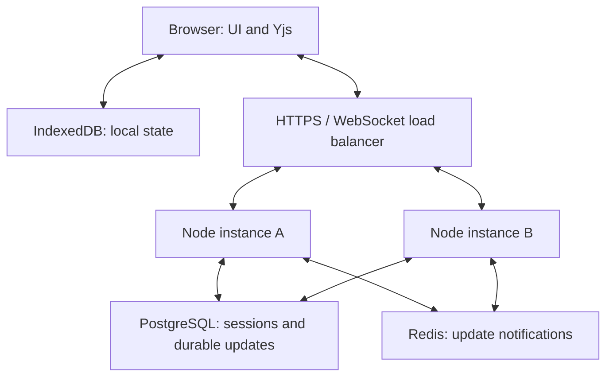

# TeamSync architecture

The single-instance development version substitutes SQLite for PostgreSQL and does not require Redis. The service worker stores only the UI shell/assets; API responses are excluded.

## Update flow

1. Local edits change a Y.Text or task Y.Map and are persisted through y-indexeddb.
2. A client sends a base64-encoded Yjs update over its authenticated WebSocket.
3. Server checks session expiry, membership, role, rate, payload, CRDT state size and task schema.
4. A per-room queue inserts the update into durable storage.
5. Server applies it, sends acknowledgement and broadcasts to local connected clients.
6. A Redis notification tells other instances to reconcile missing database rows.
7. A periodic database pass recovers missed notifications.

A server acknowledgement indicates a database write; it does not guarantee every teammate has received that edit. Other clients can recover by replay/reconnect.

## Reconnect

Load browser state → receive server state → CRDT merge → send full local state → persist and acknowledge → stream incremental edits. No whole-document last-write-wins overwrite is used.

## Failure handling

| Failure | Behavior |
| --- | --- |
| Device offline | Opened spaces remain editable in IndexedDB; UI shows local-only save state. |
| Server restart | Replays durable update log when room is reopened. |
| Redis notification lost | Periodic durable reconciliation fetches missing updates. |
| Slow WebSocket consumer | Connection closed at buffered-output limit; client reconnects. |
| Expired/logout session | Socket terminates; user signs in again. |
| Read-only viewer | Server rejects updates, independent of client UI. |
| Database write fails | No save acknowledgement; local state remains available for reconnect retry/export. |

## Production work still needed

Load benchmarks, monitored SLOs, schema migrations, shared authentication rate limits, database backups, browser QA, revocable/one-use invitation management, workspace/member deletion, and operational recovery drills. These are distinct from the implemented learning-project behavior.
